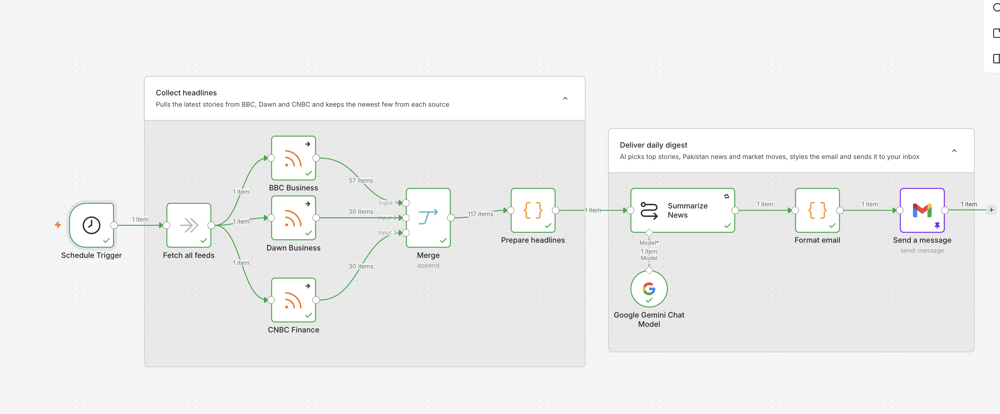

# n8n Finance News Digest (RSS + Gemini + Gmail)

A beginner-friendly n8n workflow that reads finance headlines from three RSS feeds every morning, asks Google Gemini to summarize them, and emails you a short digest through Gmail.

> Not financial advice. The digest is an AI summary of public headlines and may contain mistakes. Always read the original articles.

## What it does

1. Schedule Trigger starts the workflow daily.
2. Three RSS Read nodes fetch headlines: BBC Business, Dawn Business, CNBC Finance.
3. Merge combines them, and a Code node keeps the newest 6 per source.
4. Gemini (Basic LLM Chain) writes a short HTML digest.
5. Gmail sends it to you.

```
Schedule -> BBC Business  \
         -> Dawn Business  -> Merge -> Prepare headlines -> Summarize news (Gemini) -> Gmail
         -> CNBC Finance  /
```



## Requirements

- An n8n account (Cloud or self-hosted)
- A Google Gemini API key (free tier from Google AI Studio)
- A Gmail account

## Setup

1. In n8n, click **Create workflow**, then the three dots, **Import from file**, and choose `workflows/finance-news-digest.json`.
2. Open the **Summarize news** node, create a Gemini credential with your API key, and pick a current Flash or Flash-Lite model from the dropdown.
3. Open the **Gmail** node, connect your Google account, and set the **To** address to your own email.
4. Optional: replace the RSS feed URLs with your own favourite sources.
5. Click **Execute workflow** to test, then switch the workflow to **Active**.

## Lessons learned

- Unpin test data (pin icon) before going live, otherwise n8n replays saved data.
- Limit items before sending them to an AI node to stay inside free-tier limits.
- Gemini may wrap HTML in code fences; the Gmail node strips them with an expression.
- Set RSS nodes to **On Error: Continue** so one broken feed does not stop the digest.

## Privacy and safety

- No API keys, credential IDs or email addresses are stored in this repo. Replace the `YOUR_...` placeholders after import.
- Free-tier AI prompts may be used by the provider, so only send public headlines.
- The workflow sends headlines and links only, not full article text. Respect each site's terms.

## License

MIT, see [LICENSE](LICENSE).
